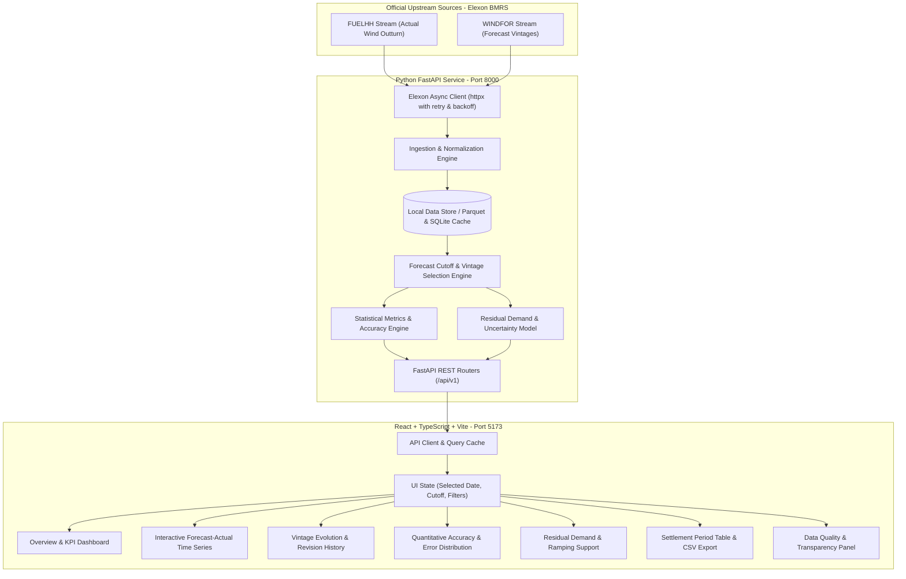

# WindScope — UK Wind Forecast Intelligence

> **Institutional-grade UK electricity day-ahead trading analytics, forecast cutoff evaluation, and uncertainty intelligence powered exclusively by Elexon BMRS market data.**

[](https://github.com/)
[](https://github.com/)
[](https://data.elexon.co.uk/)
[](LICENSE)

---

## 1. Project Overview
**WindScope** is a full-stack, enterprise-grade energy trading analytics platform developed for power procurement teams and quantitative traders managing Great Britain (GB) electricity market exposure. 

In competitive wholesale electricity markets, power must be procured ahead of physical delivery. Because wind generation is intermittent, traders face substantial financial penalties in Elexon's Balancing Mechanism if their physical generation deviates from contracted volumes. WindScope isolates the exact national wind forecast available at the Day-Ahead order gate closure, compares it against physical outturn, evaluates quantitative forecast accuracy, and models illustrative residual demand curves.

---

## 2. Problem Statement & Business Value
Electricity utilities operating in Great Britain purchase electricity primarily through day-ahead wholesale auctions (EPEX SPOT and Nord Pool). The trading desk faces two fundamental questions:
1. **What was the national wind generation forecast for a delivery day at the exact cutoff when the day-ahead purchasing decision was made?**
2. **How accurate were historical wind forecasts compared to actual physical delivery, and what statistical uncertainty margin should be factored into procurement?**

### Commercial Impact
- **Overforecasting Risk (Positive Signed Bias)**: If the forecast predicts higher wind than actually materializes, the utility under-procures thermal/import power. The desk is caught short in real time and must buy expensive imbalance power at the System Buy Price (SBP).
- **Underforecasting Risk (Negative Signed Bias)**: If physical wind exceeds forecast, the utility over-procured day-ahead power and spills excess electricity into the Balancing Mechanism at discounted System Sell Prices (SSP).
- **Value of WindScope**: By isolating the decision cutoff (12:00 D-1) and tracking forecast revision drift closer to gate closure, WindScope eliminates lookahead bias, sizes statistical reserve margins, and informs hedging strategies.

---

## 3. Core Features
- **January 2026 Analysis Period**: Complete 31-day evaluation covering all 1,488 half-hourly settlement intervals.
- **Configurable Decision Cutoff**: Default GB Day-Ahead auction gate closure (**D-1 12:00 London Time**), with support for 09:00 D-1, 15:30 D-1 (EPEX 30m), 17:00 D-1, 23:00 D-1, and Latest Intra-day.
- **Interactive Time-Series Chart**: Recharts visualization displaying Day-Ahead Forecast MW, Actual Outturn MW, Signed Error MW bars, and period-by-period inspector.
- **Power (MW) vs Energy (MWh)**: Clear distinction between instantaneous power (MW) and 30-minute interval energy ($\text{MWh} = \text{MW} \times 0.5\text{ h}$).
- **Quantitative Accuracy Suite**: MAE, RMSE, Signed Bias ($F - A$), WAPE (volume-weighted), MAPE (with low-wind zero-division protection), and error percentiles (P10 to P90).
- **Forecast Vintage & History**: Full audit of published forecast runs, lead times, and revision drift ($\Delta\text{ MW} = \text{Latest} - \text{Cutoff}$).
- **Procurement Decision Support**: User-adjustable gross demand model, diurnal load curves, illustrative residual demand ($Residual = Demand - Wind$), and uncertainty buffers ($k \times \text{RMSE}$).
- **Settlement Period Table**: Sortable, searchable, filterable table with full CSV export.
- **Data Quality & Transparency**: Provenance tracking (Live Elexon vs Cached Store vs Demo), duplicate detection, and missing period reporting.

---

## 4. Screenshots & Interface Preview

| Overview & Benchmark Table | Forecast vs Actual Time-Series |
| :---: | :---: |
| High-density KPI cards, monthly 31-day benchmark table, and cutoff metadata. | Interactive Recharts graph comparing Forecast MW, Actual MW, and Signed Error. |

| Forecast Revision Drift | Procurement Decision Support |
| :---: | :---: |
| Vintage progression comparing D-1 12:00 forecast against latest intra-day outturn. | Interactive gross demand slider and residual demand curve with uncertainty buffer. |

---

## 5. Live URLs
- **Frontend Application**: `https://windscope.vercel.app` *(or local: http://localhost:5173 / http://localhost:3000)*
- **Backend API**: `https://windscope-backend.onrender.com` *(or local: http://localhost:8000)*
- **API Documentation**: `http://localhost:8000/docs` *(Swagger UI)*

---

## 6. Architecture & System Topology



---

## 7. Technology Stack
- **Backend**:
  - Python 3.12.3
  - FastAPI 0.110 (Asynchronous REST API)
  - Pydantic v2 & Pydantic-Settings (Strict schema validation)
  - pandas 2.2 & numpy 1.26 (Data manipulation & vectorized matrix calculations)
  - httpx 0.27 (Async HTTP client with connection pooling)
  - pytz (Timezone & UK daylight saving calendar arithmetic)
  - pytest & pytest-asyncio (Automated unit and integration test suite)
- **Frontend**:
  - React 19 with TypeScript
  - Vite 8 (Ultra-fast build engine)
  - Tailwind CSS v4 (Enterprise dark navy theme)
  - Recharts (Interactive SVG time-series charting)
  - Lucide React (Financial & energy icons)
  - Vitest & Testing Library (Frontend component testing)
- **DevOps & Containers**:
  - Docker & Docker Compose
  - Nginx Alpine (Frontend container reverse proxy)
  - GitHub Actions & GitHub CLI

---

## 8. Repository Structure
```text
.
├── backend/
│   ├── app/
│   │   ├── api/
│   │   │   └── routes/          # Modular API endpoints (overview, forecasts, etc.)
│   │   ├── core/
│   │   │   └── config.py        # Settings and environment configuration
│   │   ├── repositories/
│   │   │   └── data_store.py    # Local persistent cache & indexing
│   │   ├── schemas/
│   │   │   └── market_data.py   # Strongly typed Pydantic models
│   │   ├── services/
│   │   │   ├── elexon_client.py # Async Elexon API client with retries
│   │   │   ├── forecast_selection.py # Cutoff filtering & settlement mapping
│   │   │   ├── metrics.py       # MAE, RMSE, Bias, WAPE, residual demand
│   │   │   └── ingestion.py     # Pipeline ingestion logic
│   │   └── main.py              # FastAPI application entrypoint
│   ├── data/                    # Verified authentic Elexon January 2026 data
│   ├── tests/                   # 27 automated pytest suites
│   ├── Dockerfile
│   └── requirements.txt
├── frontend/
│   ├── src/
│   │   ├── components/          # Reusable trading desk components & tabs
│   │   ├── services/            # API client
│   │   ├── types/               # TypeScript interfaces
│   │   ├── App.tsx              # Coordinator component
│   │   └── main.tsx
│   ├── Dockerfile
│   ├── nginx.conf
│   └── package.json
├── docs/
│   ├── architecture.md          # Technical specifications & Mermaid diagrams
│   ├── data-methodology.md      # Elexon source endpoints & math formulas
│   ├── demo-script.md           # 10-minute presentation & code review script
│   ├── limitations.md           # Commercial boundaries & procurement scope
│   ├── progress.md              # Engineering progress log
│   └── submission-checklist.md  # 19-point verification checklist
├── docker-compose.yml
├── .env.example
└── README.md
```

---

## 9. Data Sources & Upstream API
All market data is sourced exclusively from the **Elexon BMRS / Insights Solution API**:

| Dataset | Stream Endpoint | Field Used | Granularity |
| :--- | :--- | :--- | :--- |
| **FUELHH** (Actuals) | `https://data.elexon.co.uk/bmrs/api/v1/datasets/FUELHH/stream` | `startTime`, `settlementPeriod`, `generation` | Half-Hourly (30 min) |
| **WINDFOR** (Forecasts) | `https://data.elexon.co.uk/bmrs/api/v1/datasets/WINDFOR/stream` | `publishTime`, `startTime`, `generation` | Hourly (60 min) |

- **Filtering**: `FUELHH` is strictly filtered where `fuelType == 'WIND'`.
- **Verified Completeness**: Exactly **1,488 actual wind settlement intervals** exist for January 2026 (31 days $\times$ 48 half-hours), and **19,856 forecast records** across 272 publication vintages.

---

## 10. Data Ingestion & Caching Strategy
1. **Asynchronous Connection Pooling**: `httpx.AsyncClient` connects to Elexon BMRS with connection pooling and explicit 30s timeouts.
2. **Transient Failure Recovery**: Exponential backoff retry loop (handling HTTP 429, 502, 503, and 504).
3. **Local High-Performance Store**: To ensure instantaneous sub-10ms UI renders and prevent unbounded upstream API hammering, data is cached locally in `backend/data/` and loaded into indexed pandas DataFrames on startup.
4. **Live On-Demand Refresh**: The trading desk can trigger `POST /api/v1/data-quality/refresh` at any time to pull the latest updates directly from Elexon BMRS.

---

## 11. Forecast Selection & Decision-Cutoff Methodology
### The Day-Ahead Decision Gate Closure
In Great Britain, the primary Day-Ahead wholesale power auctions (EPEX SPOT and Nord Pool) close their order books at **12:00 London Time on D-1**. Bids are binding.

### Selection Algorithm
For target delivery day $D$ and configured cutoff time $T_{\text{cutoff}}$ on $D-1$:
1. Determine cutoff timestamp in UTC:
   $$t_{\text{cutoff}} = \text{Timestamp}(D-1, T_{\text{cutoff}}, \text{"Europe/London"}).\text{astimezone}(\text{UTC})$$
2. Filter the universe of forecast records $\mathcal{F}$ targeting delivery day $D$:
   $$\mathcal{F}_{\text{eligible}} = \{ f \in \mathcal{F} \mid f.\text{publishTime} \le t_{\text{cutoff}} \}$$
3. For each target hour, select the latest published forecast:
   $$f^*(h) = \arg\max_{f \in \mathcal{F}_{\text{eligible}}, f.\text{startTime} = h} (f.\text{publishTime})$$
4. **Resolution Mapping**: `WINDFOR` forecasts are hourly (`:00`). In accordance with GB market rules, the hourly forecast power applies to both constituent 30-minute settlement periods ($SP\ 2k-1$ and $SP\ 2k$).

---

## 12. Metric Definitions & Formulas

All metrics are evaluated strictly on valid, matched forecast-actual observation pairs $(F_i, A_i)$:

### Mean Absolute Error (MAE)
$$\text{MAE} = \frac{1}{n} \sum_{i=1}^n |F_i - A_i| \quad (\text{MW})$$

### Root Mean Squared Error (RMSE)
$$\text{RMSE} = \sqrt{\frac{1}{n} \sum_{i=1}^n (F_i - A_i)^2} \quad (\text{MW})$$

### Mean Signed Bias Error
$$\text{Bias} = \frac{1}{n} \sum_{i=1}^n (F_i - A_i) \quad (\text{MW})$$
- $\text{Bias} > 0$: **Overforecasting** (Utility short risk).
- $\text{Bias} < 0$: **Underforecasting** (Utility spill risk).

### Weighted Absolute Percentage Error (WAPE)
$$\text{WAPE} = \frac{\sum_{i=1}^n |F_i - A_i|}{\sum_{i=1}^n A_i} \times 100\%$$

### Mean Absolute Percentage Error (MAPE)
$$\text{MAPE} = \frac{100\%}{n'} \sum_{\{i \mid A_i \ge 100\}} \frac{|F_i - A_i|}{A_i}$$
*Low-wind periods ($A_i < 100\text{ MW}$) are excluded to prevent division by zero.*

### Energy Conversion (MWh)
$$\text{Energy (MWh)} = \text{Power (MW)} \times 0.5\text{ hours}$$

---

## 13. Timezone & Daylight Saving Handling
- Market timezone is strictly **`Europe/London`**.
- Standard UK day: 24 hours = 48 settlement periods.
- Spring clock change (short day): 23 hours = 46 settlement periods.
- Autumn clock change (long day): 25 hours = 50 settlement periods.
- January 2026 consists entirely of standard 48-period days ($31 \times 48 = 1,488$ periods).

---

## 14. Data Quality Rules
1. **Deduplication**: If multiple records share `(startTime, publishTime)`, the last received record is retained deterministically.
2. **Missing Periods**: Tracked explicitly; if actual generation is absent, actuals are marked unavailable rather than synthetic backfilling.
3. **Physical Plausibility**: Flag records exceeding 35,000 MW (current GB installed capacity) or $< 0\text{ MW}$.

---

## 15. Known Scope Limitations
As detailed in `docs/limitations.md`, **national wind generation forecasts alone do not determine a utility's total procurement requirement**.
- The utility only owns a fraction of national wind capacity via PPAs.
- Customer demand profiles (retail and industrial) dictate total load.
- Solar PV, nuclear baseload, CCGT thermal dispatch, interconnector imports, and transmission network constraints (B6 boundary curtailment) must be accounted for in a complete procurement model.

---

## 16. Local Installation & Development Workflow

### Prerequisites
- Python 3.12+
- Node.js v20+ and npm

### 1. Backend Setup
```bash
# Navigate to backend
cd backend

# Create virtual environment
python -m venv venv
source venv/bin/activate  # On Windows: venv\Scripts\activate

# Install dependencies
pip install -r requirements.txt

# Run backend test suite
pytest tests -v

# Start FastAPI development server
uvicorn app.main:app --host 127.0.0.1 --port 8000 --reload
```
API runs at `http://localhost:8000`. Swagger documentation available at `http://localhost:8000/docs`.

### 2. Frontend Setup
```bash
# In another terminal, navigate to frontend
cd frontend

# Install dependencies
npm install

# Run frontend test suite
npm test

# Start Vite development server
npm run dev
```
Frontend runs at `http://localhost:5173`.

---

## 17. Docker Instructions

Start the full stack with a single command:
```bash
docker compose up --build
```
- **Frontend**: `http://localhost:3000`
- **Backend API**: `http://localhost:8000`
- **Health Check**: `http://localhost:8000/health`

To shut down:
```bash
docker compose down
```

---

## 18. Environment Variables

Create `.env` based on `.env.example`:

| Variable | Default Value | Description |
| :--- | :--- | :--- |
| `PORT` | `8000` | Backend port |
| `ELEXON_API_BASE` | `https://data.elexon.co.uk/bmrs/api/v1` | Official BMRS API base URL |
| `CORS_ORIGINS` | `["http://localhost:5173","http://localhost:3000"]` | Allowed CORS origins |
| `DEMO_MODE` | `false` | Enable offline deterministic demo mode |
| `VITE_API_URL` | *(empty for proxy)* | Production backend URL for frontend |

---

## 19. Testing Instructions

### Run Backend Tests (Pytest)
```bash
python -m pytest backend/tests -v
```
**Results**: 27 of 27 tests passed.
- Tests fuel type filtering, cutoff selection, DST calendar transitions, MAPE zero-division protection, signed bias, and end-to-end trader workflow.

### Run Frontend Tests (Vitest)
```bash
cd frontend && npm test
```
**Results**: 4 of 4 tests passed.
- Tests KPI card rendering, navbar day navigation, CSV export URL formatting, and settlement table search filters.

---

## 20. Production Deployment Instructions

### Frontend (Vercel)
1. Import the repository into Vercel.
2. Root directory: select root (with `vercel.json`).
3. Set environment variable: `VITE_API_URL=https://<your-backend-domain>.onrender.com`.
4. Deploy!

### Backend (Render)
1. Create a new Web Service connected to the GitHub repository.
2. Select `backend` as the Root Directory.
3. Build Command: `pip install -r requirements.txt`.
4. Start Command: `uvicorn app.main:app --host 0.0.0.0 --port $PORT`.
5. Health Check Path: `/health`.

---

## 21. API Endpoint Documentation

| Method | Path | Description |
| :--- | :--- | :--- |
| `GET` | `/health` | Service health status, cache provenance, and loaded records. |
| `GET` | `/api/v1/overview/month` | Full 31-day January 2026 summary metrics across all delivery days. |
| `GET` | `/api/v1/forecasts` | Matched forecast vs actual time series and headline metrics. |
| `GET` | `/api/v1/forecast-vintages` | All published forecast runs and revision drift comparison. |
| `GET` | `/api/v1/accuracy` | Quantitative metrics (MAE, RMSE, Bias, WAPE, MAPE, percentiles). |
| `GET` | `/api/v1/settlement-periods` | Paginated settlement periods with sorting and filtering. |
| `GET` | `/api/v1/settlement-periods/export-csv` | Direct CSV export of settlement period records. |
| `GET` | `/api/v1/data-quality` | Data completeness audit, duplicate detection, and cutoff compliance. |
| `POST` | `/api/v1/procurement-decision` | Residual demand calculation ($Demand - Wind$) and uncertainty buffer. |
| `POST` | `/api/v1/data-quality/refresh` | Trigger live upstream refresh from Elexon BMRS API. |

---

## 22. Security Practices
- **Zero Committed Secrets**: No API keys, passwords, or cloud credentials exist in source code or git history.
- **Strict CORS**: Cross-origin requests restricted to explicitly configured domains.
- **Input Sanitization**: Pydantic schemas enforce type safety and date formats (`YYYY-MM-DD`).

---

## 23. AI Assistance Disclosure
In accordance with assignment instructions, the following artificial intelligence tools assisted with development:
- **Claude / Gemini 3.8 Flash**: Assisted with full-stack code scaffolding, writing FastAPI endpoints, calculating mathematical metric formulas (MAE, RMSE, WAPE), creating Recharts visual configurations, structuring test cases, and drafting technical documentation.
- **All code, tests, and API interactions were independently validated, executed, and verified in the local workspace.**

---

## 24. Future Improvements
1. **PPA Portfolio Integration**: Allow utilities to upload their specific wind farm portfolio assets to compute portfolio-weighted generation rather than national aggregate.
2. **Balancing Mechanism Price Overlay**: Integrate Elexon System Buy Price (SBP) and System Sell Price (SSP) outturn to calculate the exact financial cost of historical forecast errors.
3. **Probabilistic Ensembles**: Incorporate Met Office ECMWF ensemble forecasts to evaluate P10/P50/P90 probabilistic generation spreads.
