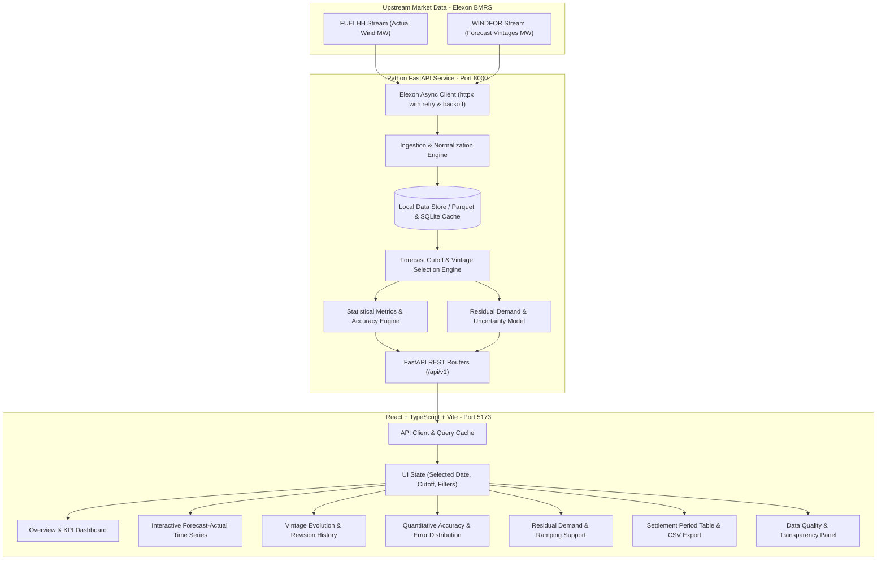
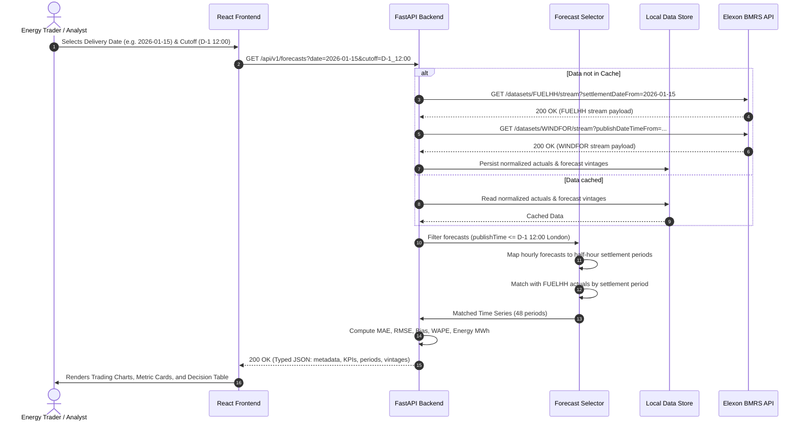

# WindScope — System Architecture & Technical Specifications

## 1. System Overview
**WindScope** is structured as a decoupled full-stack analytics application designed for institutional trading performance, strict timestamp precision, and resilient upstream failure tolerance.

---

## 2. Component Responsibilities

### 2.1 Backend (`backend/`)
- **`app/core/config.py`**: Pydantic `BaseSettings` reading environment variables (`API_V1_STR`, `ELEXON_API_BASE`, `CORS_ORIGINS`, `CACHE_DIR`, `DEMO_MODE`).
- **`app/services/elexon_client.py`**: Asynchronous HTTP client wrapping `httpx.AsyncClient` with:
  - Connection pooling and keep-alive.
  - Configurable timeouts (e.g. 30s read, 10s connect).
  - Retry mechanism with exponential backoff on transient errors (502, 503, 504, 429).
- **`app/services/ingestion.py`**:
  - Pulls `FUELHH` and filters records to `fuelType == 'WIND'`.
  - Pulls `WINDFOR` forecast records.
  - Normalizes schemas, validates data types, handles timezone parsing (`UTC` and `Europe/London`).
- **`app/repositories/data_store.py`**:
  - Persistent local file/SQLite cache for rapid queries and instant startup.
  - Built-in fallback to bundled deterministic test fixtures if upstream Elexon is unavailable.
- **`app/services/forecast_selection.py`**:
  - Generates expected settlement periods for any day in `Europe/London` (accounting for standard 48, spring 46, autumn 50 periods).
  - Evaluates decision cutoff: selects forecasts where $publishTime \le cutoff$.
  - Maps hourly WINDFOR forecasts to constituent half-hourly settlement periods.
  - Matches forecast and actual records by settlement period and interval start.
- **`app/services/metrics.py`**:
  - Computes quantitative accuracy metrics: MAE, RMSE, Signed Bias, WAPE, MAPE, and total energy (MWh).
  - Computes forecast error percentiles and distribution.
- **`app/schemas/`**: Pydantic models for request query params and strongly typed response payloads.
- **`app/api/routes/`**: Clean modular route controllers.

### 2.2 Frontend (`frontend/`)
- Built with **React 18/19**, **TypeScript**, and **Vite**.
- Styled using **Tailwind CSS** with a custom institutional trading desk theme.
- Charting powered by **Recharts** for time-series charts, residual demand curves, and revision drift.
- Navigation tabs for comprehensive domain exploration:
  1. **Overview**: Executive summary, day selection, headline KPIs, monthly aggregation.
  2. **Forecast Analysis**: Interactive time-series comparing forecast vs actual, signed error bar, cutoff indicator.
  3. **Forecast Vintages**: Timeline of published revisions, vintage comparison table, delta analysis.
  4. **Accuracy & Quantitative Metrics**: MAE, RMSE, Signed Bias, WAPE, error distribution, D-1 vs Latest comparison.
  5. **Procurement Support**: User-adjustable demand profile, residual demand curve, uncertainty buffers.
  6. **Settlement Periods Table**: Sortable, searchable, filterable table with full CSV export.
  7. **Data Quality & Methodology**: Transparency audit (missing intervals, duplicate counts, cutoff adherence, data source status).

---

## 3. Sequence Diagram: Data Retrieval & Forecast Evaluation

---

## 4. API Specification Summary

| Method | Endpoint | Description |
| :--- | :--- | :--- |
| `GET` | `/health` | Service health status, uptime, and cache readiness. |
| `GET` | `/api/v1/overview` | High-level summary of January 2026 metrics, dates, and monthly aggregates. |
| `GET` | `/api/v1/forecasts` | Time series of forecast, actual, and error for a delivery date and cutoff. |
| `GET` | `/api/v1/forecast-vintages` | All available forecast publication runs targeting the selected delivery day. |
| `GET` | `/api/v1/accuracy` | Statistical metrics (MAE, RMSE, Bias, WAPE, MAPE) for selected day or entire month. |
| `GET` | `/api/v1/settlement-periods` | Detailed settlement period list with filtering, sorting, and pagination. |
| `GET` | `/api/v1/data-quality` | Audit report on data completeness, missing periods, duplicates, and source provenance. |
| `POST` | `/api/v1/refresh` | Trigger upstream cache refresh from Elexon API. |

---

## 5. Security & Deployment Architecture

- **No Secrets in Source**: No API tokens or passwords are baked into code or client bundles.
- **CORS Protection**: Explicit allowed origins configured in backend environment variables.
- **Containerization**:
  - `backend/Dockerfile`: Multi-stage or optimized Python 3.12 slim container running Uvicorn.
  - `frontend/Dockerfile`: Multi-stage Node.js build with static files served by Nginx or Caddy.
  - `docker-compose.yml`: Single-command local spin-up with port mapping (`8000` for backend, `3000`/`5173` for frontend).
- **Production Hosting**:
  - Frontend: Vercel deployment with client-side routing rewrites (`vercel.json`).
  - Backend: Render / Railway / Fly.io container deployment with health checks.
